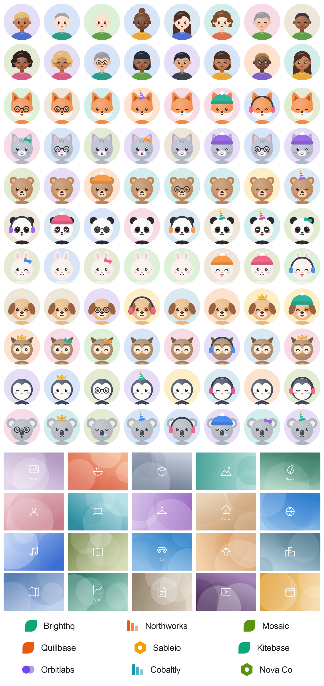

# placeholderkit

Placeholder images, avatars, logos and icons for React and HTML. Built for prototypes, mockups and AI-built apps.

- **Same seed, same image.** Pass a user id, email or product id and get a stable image every render.
- **No network.** Everything is generated as SVG in the browser or on the server. Works offline, in sandboxes and in CI.
- **One package, any stack.** React components, plain functions that return URLs, or a script tag for plain HTML.



## Install

```bash
npm install placeholderkit
```

## React

```jsx
import { Avatar, AnimalAvatar, Placeholder, Logo } from "placeholderkit/react";
import { Icon } from "placeholderkit/icons"; // optional, needs lucide-react

<Avatar seed={user.email} />                         // person avatar
<AnimalAvatar seed={user.id} animal="fox" size={64} /> // the same fox, different look per user
<Placeholder seed={dish.id} category="food" ratio="4/3" />
<Placeholder seed="hero" category="travel" ratio="21/9" label="Hero image" />
<Logo seed="acme" name="Acme" height={28} />
<Logo seed={company.id} />                           // believable fake company + logo
<Icon name="shopping-cart" size={20} />
```

The components have no hooks, so they work in Server Components, SSR and the client.

## Plain HTML (no build step)

```html
<script src="https://cdn.jsdelivr.net/npm/placeholderkit/dist/placeholderkit.global.js"></script>


```

Images added to the page later (by a framework or your own script) fill in automatically. The global `PlaceholderKit` object exposes every function below.

## Any framework: functions

```js
import { avatarUrl, animalUrl, placeholderUrl, logoUrl, animalSvg } from "placeholderkit";

avatarUrl({ seed: "ana" });                                 // person; data:image/svg+xml,... for  or CSS
animalUrl({ seed: "u7", animal: "panda" });
placeholderUrl({ seed: "p1", category: "product", ratio: "1/1" });
logoUrl({ seed: "acme", variant: "mark" });
animalSvg({ seed: "u7", animal: "cat" });                  // raw SVG string
```

## Options

### Avatar and AnimalAvatar

`<Avatar>` / `avatarUrl` draw people; `<AnimalAvatar>` / `animalUrl` draw animal characters. They're separate so an app that only uses one doesn't download the other's drawings.

| Prop | Values | Default |
|---|---|---|
| `seed` | any string | required |
| `size` | number (px) or CSS length | `40` |
| `shape` | `circle`, `rounded`, `square` | `circle` |
| `background` | any color or `transparent` | picked from seed |
| `hairstyle` (Avatar) | `short`, `long`, `bun`, `curly`, `bob`, `buzz`, `none` | picked from seed |
| `animal` (AnimalAvatar) | `fox`, `cat`, `bear`, `panda`, `rabbit`, `dog`, `owl`, `frog`, `penguin`, `koala` | picked from seed |
| `expression` (AnimalAvatar) | `happy`, `joy`, `wink`, `sleepy`, `surprised`, `smirk` | picked from seed |
| `accessory` (AnimalAvatar) | `none`, `glasses`, `party-hat`, `bow`, `headphones`, `crown`, `beanie` | picked from seed |

### Placeholder

| Prop | Values | Default |
|---|---|---|
| `seed` | any string | required |
| `category` | `photo`, `food`, `product`, `travel`, `nature`, `people`, `tech`, `fashion`, `home`, `sports`, `music`, `book`, `car`, `pet`, `building`, `map`, `chart`, `document`, `video`, `event` | picked from seed |
| `ratio` | `"16/9"`, `"4:3"`, `1`, ... | `"16/9"` |
| `label` | text drawn on the image | none |
| `glyph` | `false` hides the category symbol | `true` |
| `width` | number (px) or CSS length | fills container |

### Logo

| Prop | Values | Default |
|---|---|---|
| `seed` | any string | required |
| `name` | company name | generated from seed |
| `variant` | `full`, `mark` | `full` |
| `color` | any color | picked from seed |
| `height` | number (px) or CSS length | `32` |

### Icon

`name` takes any [Lucide](https://lucide.dev/icons) icon name in kebab-case or PascalCase. Unknown names show a fallback icon instead of breaking the page. `Icon` loads the full Lucide set, which is fine for prototypes; in production, import icons from `lucide-react` directly.

## For AI website builders

This package ships an [`llms.txt`](llms.txt) describing the full API in a compact form. Point your agent at `https://cdn.jsdelivr.net/npm/placeholderkit/llms.txt`.

## Roadmap

- Photo-style packs (food, products, interiors, people) served from the CDN, same seed API
- More characters and styles
- Vue, Svelte and Solid components
- Figma plugin

## License

MIT for code and all generated images. Lucide icons are ISC licensed.
